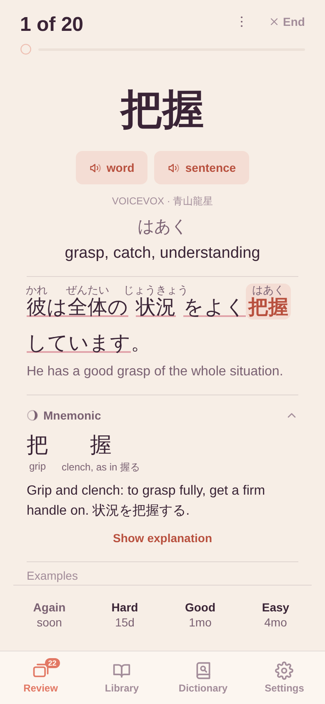
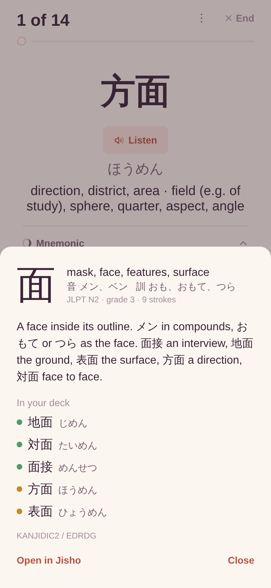
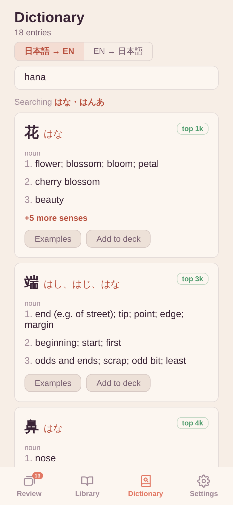
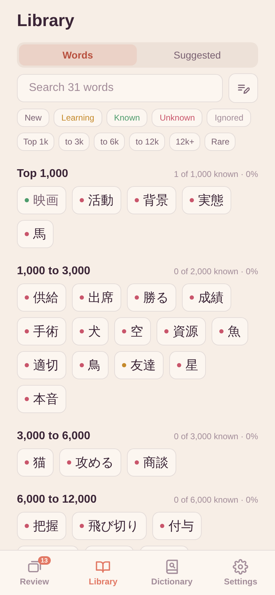

# Yume: a Japanese flashcard app your AI tutor keeps improving

Look words up, review them on your phone, and let Claude or ChatGPT add
sentences, mnemonics, and audio to your cards. Yume runs on your own
computer or a Raspberry Pi, so your deck and study history stay yours.

<!-- TODO(demo): put the hosted demo link and a short GIF of a review here,
     above the screenshots, once a demo site exists. -->

<p align="center">
  
  
  
  
</p>

## What Yume includes

- Japanese and English dictionary search, including romaji input
- FSRS reviews with offline rating support
- Vocabulary coverage by frequency band and kanji progress
- Example sentences, furigana, mnemonics, notes, and optional audio
- Suggested words from your AI tutor or Japanese text you paste
- An MCP endpoint and a bundled `yume-sensei` tutor skill
- Anki export and deck snapshots under **Settings → Your data**
- An HTTP API, and optional accounts so several people can share one server

Without an AI tutor, Yume is a private dictionary and review app. A new
install starts with an empty deck: you add the words, and
[your tutor](#connect-your-ai-tutor) adds mnemonics, kanji stories, sentences
and audio as you go. The screenshots show a deck after a few weeks of that.

## Start in five minutes

You need [Docker Desktop](https://www.docker.com/products/docker-desktop/) or
Docker Engine with Compose.

<!-- TODO(release): once v0.1.0-alpha is tagged and the ghcr.io/yumejp/yume
     package is public, switch this to pulling the tagged image instead of
     building from source. -->

```sh
git clone https://github.com/yumejp/yume.git
cd yume
git checkout v0.1.0-alpha
```

The [releases](https://github.com/yumejp/yume/releases) list the newest tag.
So that **Settings → About** shows which release you run, create a file named
`.env` beside `docker-compose.yml`:

```env
YUME_VERSION=v0.1.0-alpha
```

Build and start the server:

```sh
docker compose up --build
```

Open [http://127.0.0.1:7654](http://127.0.0.1:7654). The first start downloads
about 21 MB of dictionary data from EDRDG over HTTPS and retries until it
succeeds. Your deck, media, settings, and study history live in the
`yume_yume-data` Docker volume, which survives restarts and rebuilds. Never
run `docker compose down -v`: `-v` deletes that volume, and your deck with it.

Start with one word:

1. Open **Dictionary** and search in kanji, kana, romaji, or English.
2. Select **Add to deck** on a useful word.
3. Open **Review** and select **Learn new words**.
4. If a card needs a better explanation, sentence, or audio, open its menu and
   leave a request for your tutor.

When that works, [put Yume on your phone](#use-yume-on-your-phone) and
[connect your AI tutor](#connect-your-ai-tutor); together they take about an
hour. The [user guide](docs/user-guide.md) covers the rest of the app.

## Connect your AI tutor

Yume exposes a Streamable HTTP MCP endpoint at `http://127.0.0.1:7654/mcp`.
Through it, an assistant can read your learning snapshot, find the cards you
flagged, suggest words, and make backups. Card content (sentences,
explanations, mnemonics, kanji stories and audio) is written through the HTTP
API, as the bundled `yume-sensei` skill teaches the assistant. The tutor
does not rate cards or change your schedule.

- **Full tutor:** an agent that can make HTTP requests on the machine running
  Yume or on the same private network: Claude Code, the Codex CLI, the Codex
  IDE extension, or Codex in the ChatGPT desktop app. Claude Code is used
  daily; Codex has had far less use, so open an issue if something behaves
  differently there.
- **Read and suggest only:** a chat app that only speaks MCP, such as Claude
  Desktop. It can read the deck, suggest words and flag cards, but it cannot
  write card content.
- **Cannot connect:** ChatGPT connectors and claude.ai custom connectors.
  They call MCP servers from the provider's cloud, which cannot reach your
  machine or private network. Do not publish Yume's open-auth port to make
  them work.

Report security problems privately, as the
[security policy](.github/SECURITY.md) describes, not in an issue.

### Claude Code

```sh
claude mcp add --transport http yume http://127.0.0.1:7654/mcp
cp -R skills/yume-sensei ~/.claude/skills/
```

### Codex CLI, IDE extension, and ChatGPT desktop app

These share MCP configuration on the same Codex host. Register Yume there:

```sh
codex mcp add yume --url http://127.0.0.1:7654/mcp
```

Then copy `skills/yume-sensei` to your personal `.agents/skills` directory;
the [AI tutor guide](docs/ai-cards.md#connect-codex-or-the-chatgpt-desktop-app)
has the commands for macOS, Linux and Windows. OpenAI's
[MCP](https://developers.openai.com/codex/mcp) and
[skills](https://developers.openai.com/codex/skills) documentation covers
other configuration options.

### Claude Desktop (read and suggest only)

Claude Desktop reaches Yume through
[`mcp-remote`](https://github.com/geelen/mcp-remote), a bridge that needs
[Node.js 18+](https://nodejs.org/). Open **Settings → Developer → Edit
Config** and add Yume under `mcpServers`:

```json
{
  "mcpServers": {
    "yume": {
      "command": "npx",
      "args": ["-y", "mcp-remote", "http://127.0.0.1:7654/mcp"]
    }
  }
}
```

Quit and restart Claude Desktop. The bridge accepts plain HTTP only for
`localhost` and `127.0.0.1`; if Yume runs on another private machine, use its
address and add `"--allow-http"` after the URL.

### Try it

Ask in plain language, for example “Use Yume Sensei to check my flagged
cards.” or “Find cards that are missing sentences or mnemonics and improve
them.” [Cards with an AI tutor](docs/ai-cards.md) has the full workflow and
[Card content](docs/card-content.md) the format Yume expects.

## Add words in bulk

- **Paste Japanese text.** Open **Library → Suggested → Scan Japanese text**
  and paste a transcript, article, or conversation. Yume finds unfamiliar
  words that repeat; you choose which to keep. The text is processed by your
  server and is not stored.
- **Use the [HTTP API](API.md).** A word is one POST to `/save_card`; a batch
  is one `/import_csv` (Anki-style columns, tagged as a batch). Undoing a
  batch removes only the words it added and keeps any you have studied
  since; words you already had keep their cards and history.
- **Ask your tutor.** Give it an Anki export, a textbook word list, or a page
  of text: “Here is my Anki export. Add the words I do not already have.”

## Use Yume on your phone

The server serves the app, so installing it means adding the page to your
home screen. The recommended path gives the server an HTTPS address on your
private [Tailscale](https://tailscale.com/download) network; Android offers
**Install app** only over HTTPS.

1. Install Tailscale on the server machine and the phone. In the admin
   console's [DNS page](https://login.tailscale.com/admin/dns), keep
   MagicDNS on and select **Enable HTTPS**. This publishes the machine's
   name, such as `yumebox.your-tailnet.ts.net`, in public certificate logs,
   so choose a name you do not mind being public. Only your tailnet can
   reach it.
2. Keep Yume on `127.0.0.1` (the Docker default) and allow that name: add
   this line to `.env`, then run Docker Compose again.

   ```env
   YUME_ALLOWED_HOSTS=yumebox.your-tailnet.ts.net
   ```

3. On the server machine, run `tailscale serve --bg 7654` (with `sudo` on
   Linux). It keeps serving `https://yumebox.your-tailnet.ts.net` after
   restarts. If it prints a link to enable HTTPS, open it and run the
   command again.
4. Open `https://yumebox.your-tailnet.ts.net` on the phone.
   - iPhone: Safari share button, then **Add to Home Screen**. Do this
     before you sign in or change settings, and use Yume from the icon:
     the home-screen app keeps its own storage, separate from Safari's.
   - Android: Chrome menu, then **Install app**.

In the default open mode, anyone who can reach the server through your
tailnet acts as the owner. Do not share the machine with other people's
devices, and never publish Yume's port on the public internet. To give each
person their own account, see
[Separate decks for several people](#separate-decks-for-several-people).

Without HTTPS certificates, bind Yume to the machine's Tailscale IP instead
(`YUME_BIND=100.101.102.103` and `YUME_ALLOWED_HOSTS=100.101.102.103` in
`.env`) and open `http://100.101.102.103:7654`. On Android you then get only
**Add to Home screen**, which opens Yume in Chrome. Without Docker, open mode
on an address other than 127.0.0.1 starts only when you set
`YUME_ALLOW_OPEN_NETWORK=1` to confirm the address is private; the Docker
Compose file sets it for you.

If the connection drops during a review, ratings wait on the device and sync
when the server is reachable again. Opening the app with no connection works
only on an HTTPS address. For a Raspberry Pi with systemd, see
[server/deploy/pi/README.md](server/deploy/pi/README.md).

## Back up and update

Stop the service while you copy its data directory, so the SQLite databases
and media form a consistent backup. Use a new destination each time:

```sh
docker compose stop yume
docker compose cp yume:/data ./yume-data-backup-2026-09-08
docker compose start yume
```

Check that the copy succeeded before restarting, and keep the folder
somewhere safe. It holds accounts, shared content, decks, and media. Deck
snapshots (**Settings → Your data**, or your tutor) cover the deck database
only, and **Download my deck** there saves an Anki `.apkg` copy. To restore,
see [backup and restore](docs/backup-and-restore.md).

To update, back up first. Then check out the newest release tag (shown here
as v0.1.0-alpha), set `YUME_VERSION` in `.env` to the same tag, and rebuild:

```sh
git fetch --tags
git checkout v0.1.0-alpha
docker compose up --build -d
```

Your deck stays in the `yume_yume-data` volume. If your install predates
v0.1.0-alpha and you cloned into a folder other than `yume`, `docker volume
ls` shows `<folder>_yume-data`; add `YUME_VOLUME=<folder>_yume-data` to
`.env` before updating. The [changelog](CHANGELOG.md) has the other upgrade
notes.

An older version will not open a database that an update has changed. To go
back to a previous tag, follow
[Roll back an upgrade](docs/backup-and-restore.md#roll-back-an-upgrade).

Once published images are available to you, `docker compose pull` followed by
`docker compose up -d` (without `--build`) runs the image for the release in
`YUME_VERSION` instead of building it, on x86-64 and ARM64 machines alike.

### Refresh the dictionary files

EDRDG's license asks installs to keep its dictionary files current. About
once a month, delete them so the next start downloads fresh copies. Your
deck is not touched.

```sh
docker compose exec yume rm /data/JMdict_e.gz /data/examples.utf.gz /data/kanjidic2.xml.gz
docker compose restart yume
```

Without Docker, stop the server, delete the same three files from the data
folder, run `./yume-server setup`, and start the server again. If a download
fails, setup names the file; run it again when the connection is back.

### Report a problem

Say what you did, what you expected, and what happened, and include:

- the output of `curl http://127.0.0.1:7654/health`, or the versions under
  **Settings → About**
- with Docker, the output of `docker compose logs --since 1h yume`
- your install method (Docker or a native build), operating system, and
  browser or phone

Open an issue with the
[bug report form](https://github.com/yumejp/yume/issues/new/choose). Report
security problems privately instead, as the
[security policy](.github/SECURITY.md) describes.

## Optional additions

### Japanese definitions

Add `YUME_DICTS=ja-ja` to `.env`, then rebuild the service. This downloads and
imports Japanese Wiktionary data (about 8 MB, CC BY-SA 4.0). Select Japanese
under **Settings → Definitions** when the import is ready.

Without Docker:

```sh
./yume-server dict ja-ja
```

### Generated audio

```sh
./yume-server voicevox
```

This installs VOICEVOX under Yume's data folder and needs
[Python 3.10+](https://www.python.org/downloads/) on the machine that runs
the server. The batch tool in [`server/tools/voicevox`](server/tools/voicevox/)
then creates missing word and sentence clips and records the voice credit on
each. A large import can take hours; stopping and re-running it is safe.

The Docker image cannot run VOICEVOX. With Docker, run the audio step on the
host against the running container, as described in
[`server/tools/voicevox`](server/tools/voicevox/README.md#with-docker).

### Separate decks for several people

By default everyone who can reach the server shares the owner's deck. With
`YUME_AUTH_MODE=required` each person signs in and gets their own. Give the
owner account a password first, or you lose access to your own deck and your
tutor. New accounts are turned off unless you set `YUME_SIGNUP=open` while
people join. Keep the server on a private network either way. Run
`yume-server users` to see the account commands; the
[server guide](server/README.md#accounts-separate-decks-on-one-server) has
the steps.

## Run without Docker

Releases after `v0.1.0-alpha` attach a ready-built server, with the app
inside, for each system. From the
[releases](https://github.com/yumejp/yume/releases), download the one file
for yours:

| System | File |
| --- | --- |
| Windows | `yume-server-windows-amd64.exe` |
| macOS, Apple silicon | `yume-server-darwin-arm64` |
| macOS, Intel | `yume-server-darwin-amd64` |
| Linux | `yume-server-linux-amd64` |
| Linux, ARM (Raspberry Pi 4 or 5, 64-bit) | `yume-server-linux-arm64` |

The release's `SHA256SUMS` lists each file's checksum; compare it with
`Get-FileHash <file>` in PowerShell or `shasum -a 256 <file>` elsewhere.
Then, in a terminal in the download folder, fetch the dictionaries once and
start the server. Windows PowerShell:

```powershell
.\yume-server-windows-amd64.exe setup
.\yume-server-windows-amd64.exe
```

macOS and Linux (with your file's name):

```sh
chmod +x yume-server-darwin-arm64
./yume-server-darwin-arm64 setup
./yume-server-darwin-arm64
```

Open [http://127.0.0.1:7654](http://127.0.0.1:7654). The files are not
code-signed, so Windows SmartScreen or macOS Gatekeeper may ask before the
first run. Where the data lives, and what happens when `setup` is skipped, is
the same as for a build of your own, described next; the
[server guide](server/README.md#run) lists the other commands and settings.
The generated-audio tool is not in the download: it needs a
[source checkout](#generated-audio).

## Build without Docker

You need [Go 1.26.11+](https://go.dev/dl/) (an older Go 1.21+ downloads
1.26.11 by itself unless `GOTOOLCHAIN=local` is set) and
[Node.js 20+](https://nodejs.org/).

```sh
git checkout v0.1.0-alpha
cd mobile
npm ci
npm run export:server
cd ../server
go build -ldflags "-X main.Version=0.1.0-alpha" -o yume-server .
./yume-server setup
./yume-server
```

`npm run export:server` bundles the app into the server; without it the
server shows a short notice instead of the app. The `-ldflags` value names
the release in `/health` and **Settings → About**; the commit is recorded
automatically when you build inside the git checkout.

The same commands work in Windows PowerShell; name the binary
`yume-server.exe` and run it as `.\yume-server.exe`. Yume stores its data
under `~/.local/share/yume`, `~/Library/Application Support/Yume`, or
`%LOCALAPPDATA%\Yume`; pass `-data DIR` to choose another folder.

If `setup` was skipped or its download failed, the server still starts, and
the app shows **Dictionary not installed** with the exact
`yume-server setup -data …` command to run before restarting the server.

For development, run `npx expo start` from `mobile` and set the server address
under **Settings → Connection**. A browser build served by Metro requires the
server to run with `YUME_DEV_CORS=1`; use that flag only for local development.

## Documentation

- [User guide](docs/user-guide.md): the app from first word to review
- [AI tutor guide](docs/ai-cards.md): connect a tutor and maintain cards
- [Card content](docs/card-content.md): formats for sentences, mnemonics, and notes
- [HTTP API](API.md): build imports, exports, and custom study flows
- [Server guide](server/README.md): configuration, accounts, and release builds
- [Changelog](CHANGELOG.md): what changed in each release and how to upgrade
- [Security model](docs/security.md): auth modes, binds, and what the server trusts
- [Privacy](PRIVACY.md): what the server stores and what it sends elsewhere

## License

Copyright (C) 2026 [swei9322](https://github.com/swei9322).

Yume is free software: you can redistribute it and modify it under the terms
of the GNU Affero General Public License, version 3, as published by the Free
Software Foundation. It comes with no warranty. The full text is in
[LICENSE](LICENSE). If you run a modified Yume for other people over a
network, the license requires you to offer them your modified source. See
[CONTRIBUTING.md](CONTRIBUTING.md) before opening a pull request.

Dictionary data: [JMdict](https://www.edrdg.org/jmdict/j_jmdict.html) and
[KANJIDIC2](https://www.edrdg.org/wiki/index.php/KANJIDIC_Project) © EDRDG ·
IPADIC © NAIST · Tanaka Corpus. See [LICENSES.md](LICENSES.md) for notices;
a running server lists every bundled dependency's license at `/licenses`.
